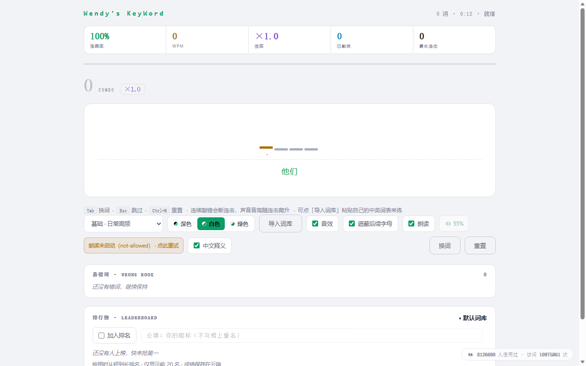

# Wendy's KeyWord

> KeyWord 既代表我帐号视频中出现的关键词，也是键盘上的键 —— 让记单词如嗦凉皮一般爽滑！
> "KeyWord" is a play on words: it stands for the keywords in my videos, and the keys on a keyboard.  Make memorizing vocabulary as smooth and satisfying as slurping a bowl of Liangpi！

做这个项目的初衷：看我视频的人很少能把内容看完，担心大家看完什么单词都没记住。于是把视频中出现过的单词按主题整理成词库，配上打字反馈、连击倍率和排行榜，让记单词变得像小游戏一样上瘾。



## 功能特性 / Features

- **主题配色**：深色 / 白色 / 绿色
- **不放回抽词**：每轮从词库不放回抽取，池空自动结束，避免重复刷同一个词
- **语音朗读**：每个单词自动朗读（有道 TTS），可开关
- **打字反馈**：连击计数、倍率累积、音调随连击升高，错的词进「易错词本」
- **排行榜**：每个词库一张榜；同一昵称保留最佳成绩；展示前 20 名
- **外挂词库 `words.txt`**：改词库 = 改一个 txt 文件，支持分类、词组、词典导出格式
- **导入 / 导出**：可粘贴自己的中文词表导入，也可把当前词库导出成 `words.txt` 格式

## 快速开始 / Quick Start

```bash
cd wendys-keyword
node server.js          # 或者 npm start
# 默认打开 http://localhost:3000
```

端口可用环境变量修改：`PORT=8080 node server.js`。

> 注意：请通过 HTTP 访问。直接双击 `index.html`（`file://` 协议）时浏览器会拦截词库请求，内置词库仍可正常使用，但外挂 `words.txt` 不会加载。

## 词库格式 / Word Bank Format

`index.html` 内置 `basic` / `mid` / `hard` 三个词库；同目录的 `words.txt` 是外挂词库，格式非常宽容：

```
# 小区周边          ← 以 # 开头的行是分类名，之后的词归到这一组
bus 公交汽车
bus stop 公交车站
"get on the bus" 上公交车    ← 带空格的词组加引号
Wi-Fi　n. 无线网络           ← 词典导出格式（全角空格 + 词性标记）
keyboard                      ← 中文释义可以省略
```

以 `##` 开头的行是注释。没有分类名的词归入「外挂词库」。改完 `words.txt` 刷新页面即可生效，不用动前端。

## API

| 方法 | 路径 | 说明 |
| --- | --- | --- |
| GET | `/api/board?bank=<词库>` | 取某个词库的榜单（前 20，按用时排序） |
| POST | `/api/score` | 提交成绩，body：`{bank, name, time, acc, combo}` |
| GET | `/api/dump` | 全量导出所有数据（备份专用） |

## 部署注意 / Deployment Notes

排行榜数据存在 `leaderboard.json`。如果你部署到「每次重新部署都会重置工作目录」的平台（某些 Serverless / 沙箱托管），**重发前必须先拉回线上数据**，否则历史成绩全部丢失：

```bash
node tools/board-backup.js pull https://你的域名   # 线上数据 → 本地备份 + leaderboard.json
# 然后再正常重新部署
```

`node tools/board-backup.js status` 可随时查看本地备份状态。建议再配一个每日定时备份（只 pull 不发布）做双保险。

`tools/dupcheck.py` 是开发小工具：检查内置词库有没有重复词条（`python tools/dupcheck.py`）。

## 目录结构 / Project Structure

```
index.html        单文件前端（全部样式与逻辑内联）
server.js         零依赖 Node 后端（静态托管 + 排行榜 API）
words.txt         外挂词库（改词库就改它）
leaderboard.json  排行榜数据（仓库中只放空模板，运行时自动创建/更新）
tools/
  board-backup.js  排行榜数据备份 / 恢复脚本
  dupcheck.py      内置词库查重
docs/             截图
```

## 第三方服务 / Third-party Services

页面用到了两个第三方服务，都可以在 `index.html` 里搜索关键字直接删除，不影响其他功能（均有容错）：

- **单词发音**：有道 TTS（搜索 `dictvoice`）
- **访问计数**：不蒜子（搜索 `busuanzi`）

## 许可证 / License

[MIT](LICENSE) © 2026 Wendy's KeyWord
