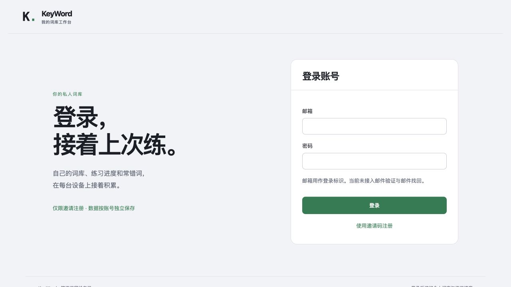
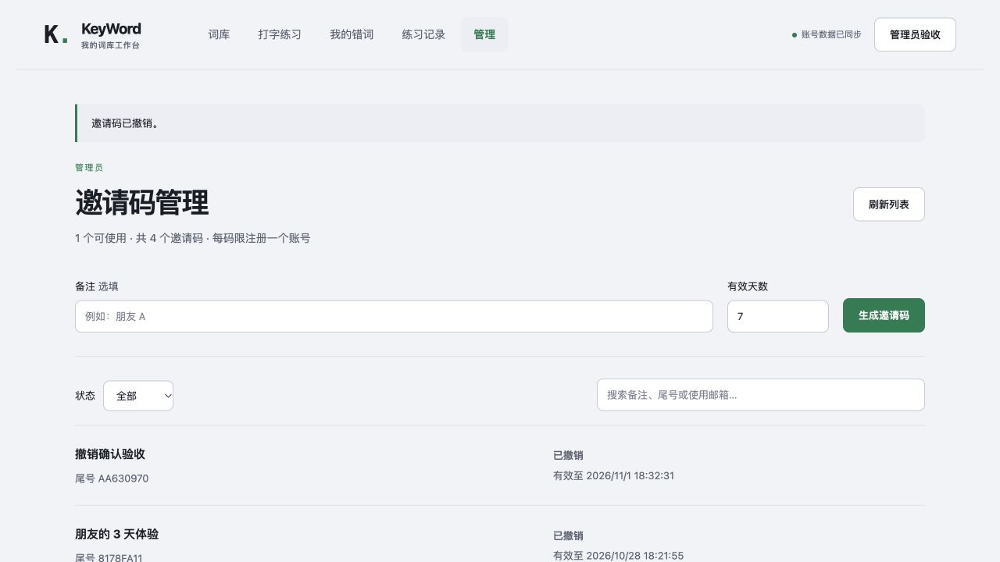

# KeyWord · 我的词库

管理自己的词库，用打字记住单词。保留连击、递进音效、震动反馈、遮蔽字母和朗读；支持多词库编辑、导入预览、断点续练、整库学习进度、动态错词本、私人账号和跨设备同步。

## 先在本机用起来

需要 **Node.js 24.15 或更高版本**。部署时优先使用受支持的 LTS 版本。

```bash
npm install
npm start
```

打开 <http://127.0.0.1:3000>。`npm start` 会先构建前端。开发模式用 `npm run dev`，仅允许本机访问。

首次使用先[初始化管理员](#管理员发放邀请码)。未登录时只显示登录与邀请码注册页；配置并开放在线购买后，也可先购买邀请码。词库、练习与历史接口均要求登录。

1. 用邀请码注册，或用已有邮箱与密码登录。
2. 点击“新建词库”，添加词条；也可以导入 TXT、CSV / TSV、JSON，检查预览后再保存。
3. “全部词库”向每个已登录账号显示同一套系统词库和该账号的私人词库。每本词库按固定随机顺序分组，每轮最多 30 个不同拼写；同词多义保留到后续组，整遍练完才重新打乱。
4. 进度自动保存。重新打开“打字练习”，点击“继续这一轮”恢复词内输入、统计与有效用时；离开期间不计时。连接同一服务并登录同一账号，就能换设备接着练。
5. 旧版访客词库仍保留在此浏览器，可在登录后复制到账号；不自动删除原件或认领旧昵称成绩。

## 词库不再靠 TXT 存储

| 用途                               | 使用方式                                             |
| ---------------------------------- | ---------------------------------------------------- |
| 日常保存、账号隔离、同步           | 服务端 SQLite，浏览器 IndexedDB 缓存断点与待同步数据 |
| Excel / Numbers 整理               | UTF-8 CSV / TSV                                      |
| 无损交换词库结构                   | JSON                                                 |
| 从旧词表快速导入                   | TXT                                                  |
| 整站备份与恢复，包含账号和历史版本 | SQLite 数据库备份                                    |

主数据在 `DATA_DIR/keyword.sqlite`（默认 `data/keyword.sqlite`）。内置词库由 `seed/decks.json` 与 `seed/catalog.json` 管理，启动时按版本同步到数据库，已有账号和私人词库不需要重建。

### 内置词库：登录后直接练习

提供高频 3000／5000、中考、高考、四级、六级、考研、雅思、托福和 GRE，共 10 本；均包含中文释义。收录范围、实际词数和公开来源见 [内置词库说明](docs/CATALOG.md)。词库详情页可查看来源与授权，复制到自己的词库后可以编辑。

### CSV：适合表格编辑

```csv
word,meaning,deck
comet,彗星,太空英语
résumé,简历,求职英语
bank,银行,求职英语
bank,河岸,求职英语
```

`deck` 可以省略；也支持表头“英文、释义、词库”。支持引号、逗号、换行、重音字母、数字和词组。同词不同义会分别保存；完全相同的词条会在导入预览中提示去重。来自公开词库的数据会附带 `source` 列以保留来源与授权说明，普通自建词表只需前三列。

CSV 导出会保护可能被 Excel 当成公式的单元格，为 `= + - @` 等开头的文本加单引号。需要无损往返这些文本时，使用 JSON。

### JSON：保留词库和词条的完整内容

```json
{
  "format": "keyword-backup",
  "version": 1,
  "decks": [
    {
      "title": "太空英语",
      "description": "自己整理的词组",
      "words": [{ "term": "comet", "meaning": "彗星" }]
    }
  ]
}
```

词库页面的导出备份包含自己的词库（含回收站）、全部服务端练习记录、学习队列、错词状态和当前账号本机的待同步副本，不包含密码或登录凭据。**JSON 导入用于新建／追加／替换词库，不恢复账号、练习记录或学习状态。整站迁移和恢复使用下面的数据库备份。**

### TXT：兼容已有词表

```text
# 旅行
bus stop 公交车站
"hello world" 你好，世界
Wi-Fi = 无线网络
```

支持 `# 分类名`、`## 注释`、引号词组、制表符和中英词表。解析不会删除数字或重音字母来“修复”英文；无效行必须修正后才能导入。每次最多 30 个词库、每库 20,000 条、文件最大 3 MB。

## 接着练，以及练熟错词

- 词库卡片显示当前遍数、已练词条和跳过数量；“已练”包含跳过，不代表已掌握。下一组不会重复本遍已练过的词条。
- 关闭页面后可恢复最近保存的输入位置。词条完成、出错和暂停都会更新本机断点；账号端约每秒合并上传，断网时保留原账号队列。
- 另一设备接续同一轮后，旧设备停止写入该轮。离线冲突不会覆盖新进度，可载入最新进度，或将本机副本另存为独立一轮；未上传副本在重新打开后仍可找到。
- “我的错词”自动收录出错或跳过的词。同词同义跨库合并并保留来源，不同义项分开；多轮反复出错优先复习。
- 连续两次独立练习均无错完成，会自动移到“已掌握”；同一次先错后补对不算无错。也可以手动移出、恢复复习。归档不删除历史，再次出错会重新加入。
- 修改词库不改变正在练的一轮；下一组接入最新版本，保留未修改词条的已练进度，新增及改变内容的词条重新进入队列。

详细规则见 [学习进度与错词本](docs/LEARNING.md)。

## 账号和跨设备同步

- **仅限邀请码注册**：新用户需输入管理员提供或在线购买的有效邀请码；已有账号正常登录，不需要补交邀请码。手工码默认 7 天有效；付费码未使用前长期有效，均只能注册一次。
- 登录由 Better Auth 管理，使用加密散列密码、HttpOnly 会话 Cookie、来源校验和数据库登录限流。
- 邮箱目前仅作为登录标识，**未配置邮件验证或邮件找回**；已登录时可在账号菜单修改密码并注销其他设备的会话。
- 私人数据由服务端按登录用户 ID 检查权限，不能通过改昵称或词库 ID 读取其他账号的数据。
- 连接同一服务、登录同一账号，即可访问同一份词库与练习记录；词库和练习记录页每 20 秒、重新聚焦及恢复联网时检查更新。
- 编辑使用版本号控制。旧版本保存返回冲突，保留编辑器草稿，不自动覆盖另一台设备的修改。
- 已登录的词库编辑需连接服务。写入失败保留草稿，可导出后重试；不会显示“保存成功”。
- 练习中的断点和完成结果均先写入本机原账号的待同步队列，再提交服务端。断网或会话过期时保留队列，仅向原账号重试；每轮记录使用独立标识避免重复提交，补传仍保留实际完成时间。
- 退出登录后立即锁定工作台。退出或切换账号会通知同一浏览器的其他标签页，清除旧账号的词库、练习视图、草稿和管理页面；待同步进度留在原账号队列。旧版访客数据只用于迁移，不开放新的访客练习。

账号、双设备与断网补传的验收方式见 [账号与同步](docs/ACCOUNT_SYNC.md)。

### 管理员发放邀请码

管理员登录后，点击顶部“管理”，即可生成、查看、复制和撤销邀请码，也可以按状态、备注、尾号或使用邮箱查找。每码限注册一个普通账号，默认 7 天有效，可指定 1–365 天。撤销前会显示确认窗口；已注册账号不受影响。

首次初始化管理员时，在部署主机运行一次（使用与服务相同的 `DATA_DIR`）：

```bash
npm run invite -- create --admin --label "站点所有者"
# Docker 部署时：
# docker compose exec keyword node tools/invite.mjs create --admin --label "站点所有者"
```

将此专用邀请码用于自己的账号注册，登录后即可进入管理页。不要把管理员初始化码发给普通用户；应用不会把第一个注册者自动升为管理员。已有账号默认保持普通用户，不能从注册字段或账号资料更新中自行提权。日常邀请操作均在页面完成，本机 `create / list / revoke <ID>` 命令仍可用于维护。

管理页创建的有效邀请码可重复查看与复制：数据库保留注册校验散列，并用登录密钥派生的 AES-256-GCM 密钥加密完整码；使用或撤销后删除密文，只留尾号与状态。本机命令及旧版仅保存散列的码无法回显，可撤销后重建。账号 JSON 导出不含邀请码，整站备份包含其状态；恢复完整码显示还需要相同的登录密钥。

服务端强制校验邀请码和管理员权限。注册仍受每个服务端识别 IP 每分钟 5 次的限制，无效邀请码会在密码计算前被拒绝；注册失败不会消耗邀请码。

### 在线购买邀请码

管理员可选开启支付宝购买：**人民币 9.90 元 / 个**，支付确认后自动发放一个普通账号注册邀请码，未使用前长期有效。支付配置默认关闭；管理员必须另外设置有限的可售余量并开放购买，不会自动无限售卖。

新用户在登录页选择“购买邀请码”，创建订单后前往支付宝付款，回来点击“查询支付结果”领取并注册。付款前可保存领取凭据；换浏览器后导入它恢复订单。领取凭据等同于此订单的访问钥匙，不要发给他人。关闭浏览器或未自动回跳时，也不要重复购买，先恢复原订单查询。

管理员的“在线售码”区可调整余量、查看最近订单、核对支付、关闭未付款订单，以及全额退还**尚未使用**的邀请码订单。退款结果未知时暂停邀请码并保留原请求；查询确认成功后才撤销并恢复库存。

独立沙箱使用 0.01 元模拟资金，正式售价仍为 9.90 元，均由服务端固定。沙箱、生产配置、订单安全边界与部署说明见 [支付宝售码](docs/PAYMENTS.md)。生产/NAS 更新由站点所有者执行；源码推送与 GitHub 镜像构建不代表支付已上线。

### 在手机与电脑之间使用

本机回环地址只能在本机访问。跨设备需把此服务放在两台设备均可访问的地址，并使用持久化磁盘。

生产运行示例（由 HTTPS 反向代理转发，保留原始 Host）：

```bash
npm run build
NODE_ENV=production \
  APP_ORIGIN=https://words.example.com \
  HOST=127.0.0.1 PORT=3000 \
  DATA_DIR=/your/persistent/keyword-data \
  node server.js
```

同时通过部署环境的密钥管理配置 `BETTER_AUTH_SECRET`，至少 32 字符，不要提交到仓库。缺少生产密钥或 HTTPS 地址时服务拒绝启动。反向代理必须允许 JSON 请求，并限制请求体与连接频率。未登录不能读取内置词库或练习记录；部署入口仍需设置连接与请求限流，防止高频请求占用资源。默认不采信转发 IP；使用 Nginx Proxy Manager 等反向代理时，由所有者设置明确的 `TRUSTED_PROXY_CIDRS`，才能按真实访客分别计算购买与登录/注册限额。配置方式与信任边界见[反向代理说明](docs/PAYMENTS.md#nginx-proxy-manager-后按真实访客限流)。

SQLite 数据目录需要放在**单台服务主机的本地持久化磁盘**，不要把数据库放在网络文件系统，也不要用多个主机各自的文件副本来“同步”。当前是单服务部署，不适用于每次部署都会清空磁盘的平台。

## 用 Docker 自动构建与部署

推送 `main` 后，GitHub Actions 会先运行检查和真实容器验收，再发布 `linux/amd64` 与 `linux/arm64` 镜像到 `ghcr.io/curtaintears/wendys-keyword`。PR 只验证、不发布；支持手动触发和 `v*` 版本标签。

使用 `compose.yaml` 部署、首次管理员初始化、备份、更新和回退方法见 [Docker 部署指南](docs/DEPLOYMENT.md)。

## 备份、恢复与更新

服务运行中可执行一致性备份：

```bash
npm run backup
# 或指定一个尚不存在的输出文件
node tools/backup.mjs /safe/location/keyword-backup.sqlite
```

备份会使用 SQLite 在线备份接口并检查数据库完整性，包含账号、会话、邀请码状态、词库历史版本和全部练习记录。文件有私密数据，不要公开上传。生产密钥需单独安全保存；本机开发密钥位于 `data/auth-secret`，请与数据库分别妥善保管。

恢复默认 `data/` 目录时：

1. 停止应用，先确认备份可用。
2. 把整个原 `data/` 目录移到另一个安全位置，不要直接覆盖运行中的数据库或遗留 WAL 文件。
3. 新建权限为 `700` 的 `data/`，将备份复制为 `data/keyword.sqlite`，文件权限设为 `600`。
4. 本机模式将原来的 `auth-secret` 一并恢复；生产模式继续使用原环境密钥。更换密钥会使旧会话失效，且旧邀请码密文不能再显示；邀请码的散列校验与账号数据仍保留。
5. 启动应用，登录后核对词库与练习记录。确认前保留原数据目录，以便回退。

更新代码后执行 `npm ci && npm start`，保留 `DATA_DIR` 与密钥。不要把运行时数据随代码重新发布或覆盖。

## 练习时使用输入法

电脑端点击词框后直接接收练习区按键，中文输入法开启时也可输入英文字母，切换输入法后无需重新开始。词库编辑、搜索和账号表单仍按正常输入法工作。手机端点击词框唤起软键盘；组字不会被中途清空，提交的英文按词条字符处理，中文候选不会计入错词。

## 安全与隐私

- 正式服务只提供 `dist/index.html` 和构建后的静态资源，不公开源码、`.git` 或数据库。
- 非法 URL、JSON、词库标识和存储异常会返回错误，不终止服务。导入和词库更新使用数据库事务。
- 释义与词条按纯文本显示，不插入可执行 HTML；页面不加载第三方统计脚本。
- 默认只选择浏览器标记为本机的英语音色，排除趣味音色；在练习页“发音与主题”中选择音色、语速与固定音量。朗读期间会压低打字音效。
- 勾选“优先在线词典发音（美音）”后，将当前练习词发送到有道获取发音，不发送释义或词库信息；在线失败时改用本机英语。关闭后会立即停止在线请求。发音偏好保存在当前浏览器，不跨设备同步。
- 历史匿名排行榜只读，不关联新账号。详细接口与数据边界见 [架构说明](docs/ARCHITECTURE.md)。

## 检查

```bash
npm test
npm run build
npm run dupcheck
```

自动检查覆盖导入解析、练习计时／切库、邀请码校验与并发一次性使用、注册失败回滚、账号隔离、来源校验、并发编辑冲突、历史版本记录、服务重启持久化和数据库备份。浏览器界面验收应覆盖注册登录、创建、导入、编辑和真实按键输入。

## 目录

```text
index.html           页面结构
src/                 词库界面、访客存储、训练状态与音频反馈
shared/             前后端共用的词条校验、解析、学习队列与错词规则
server/              登录接入、权限检查、SQLite 数据层与静态服务
seed/                版本化内置词库、收录清单与释义校订
licenses/            第三方数据授权说明
server.js            保留 node server.js 启动入口
tools/backup.mjs     整站数据库备份
tools/invite.mjs     管理员创建、查看和撤销邀请码
tests/              自动化检查
```

## 界面预览





## 许可证

基于 Wendy's KeyWord 改造，保留原项目的 [MIT 许可证与版权声明](LICENSE)。

内置词库使用 [ECDICT](https://github.com/skywind3000/ECDICT) 的公开数据，并保留其 [MIT 授权与版权声明](licenses/ECDICT-MIT.txt)。
